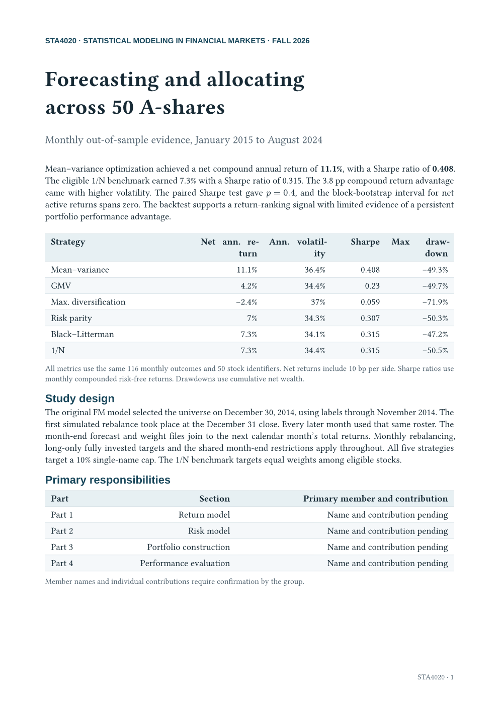
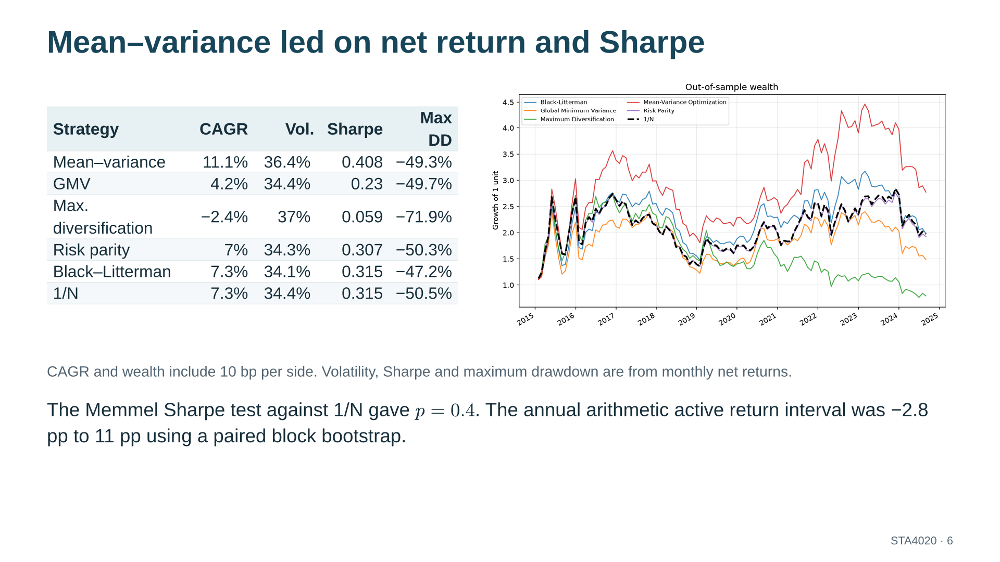
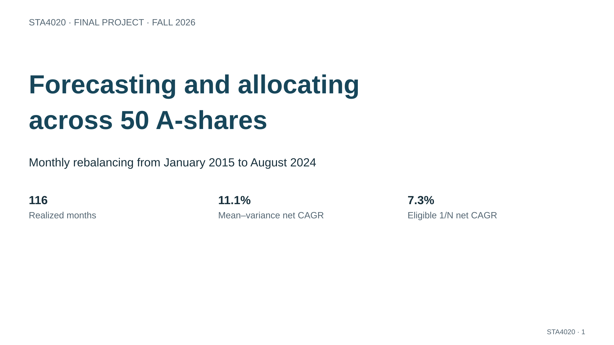
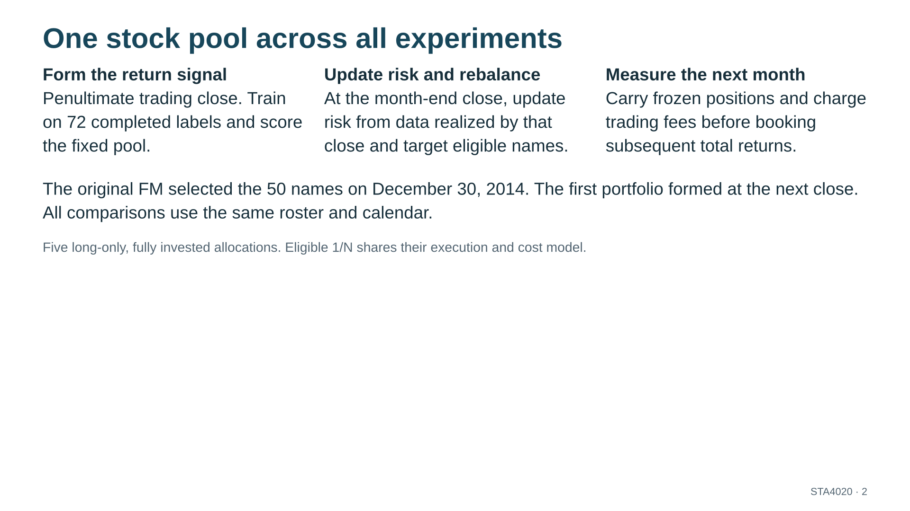
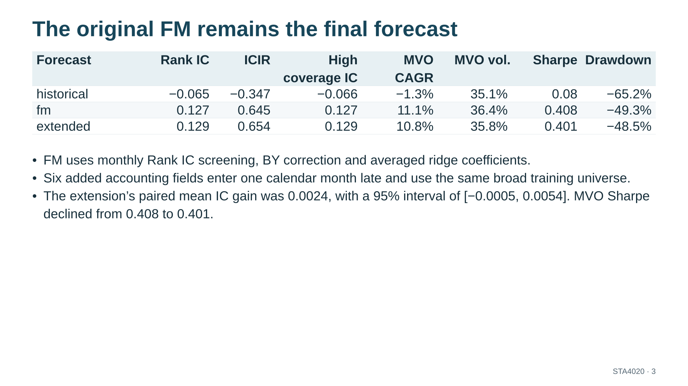
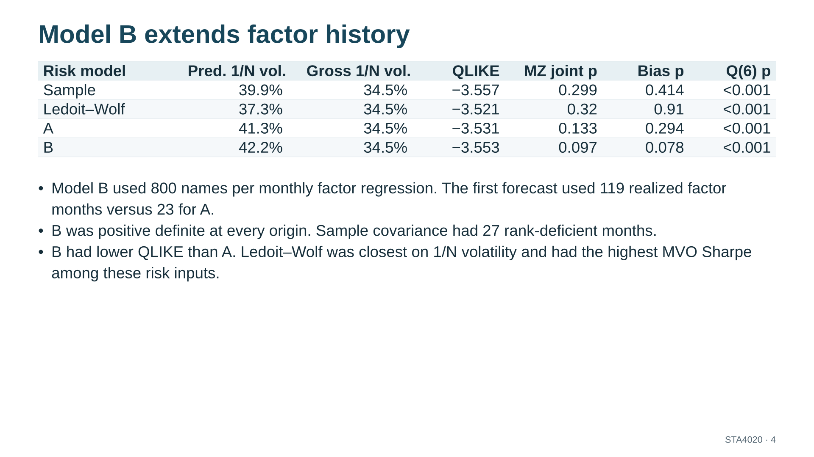
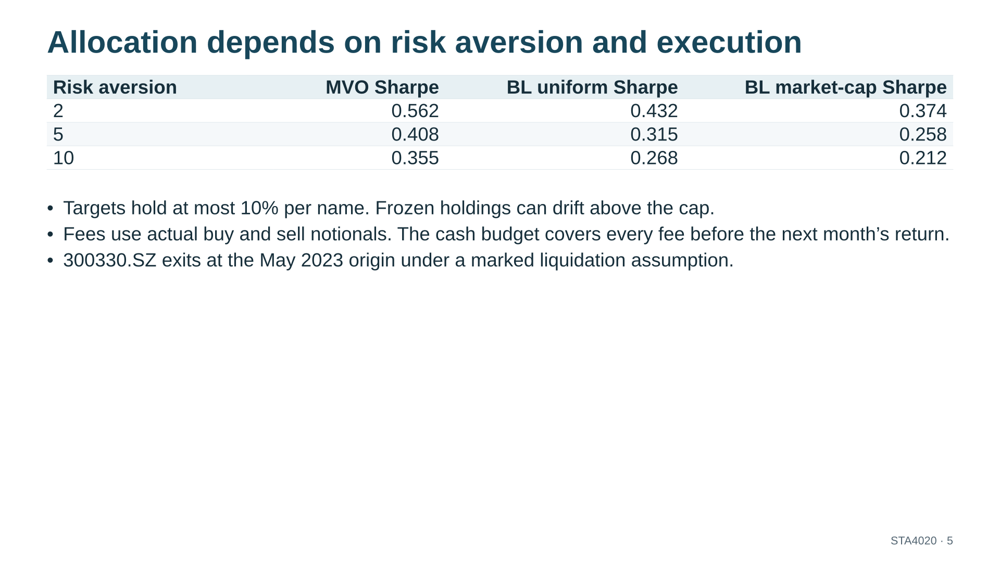
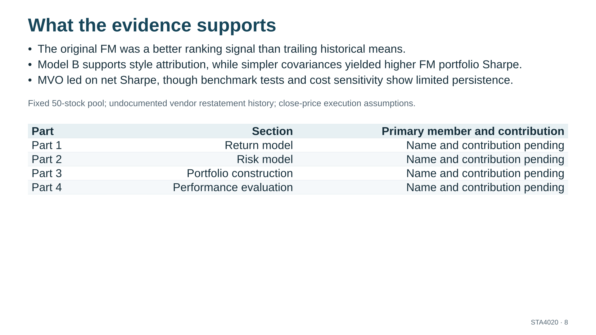
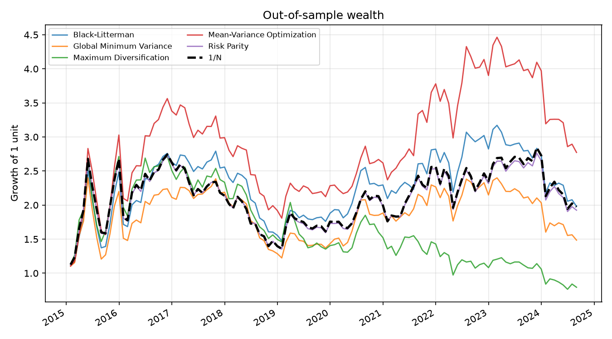
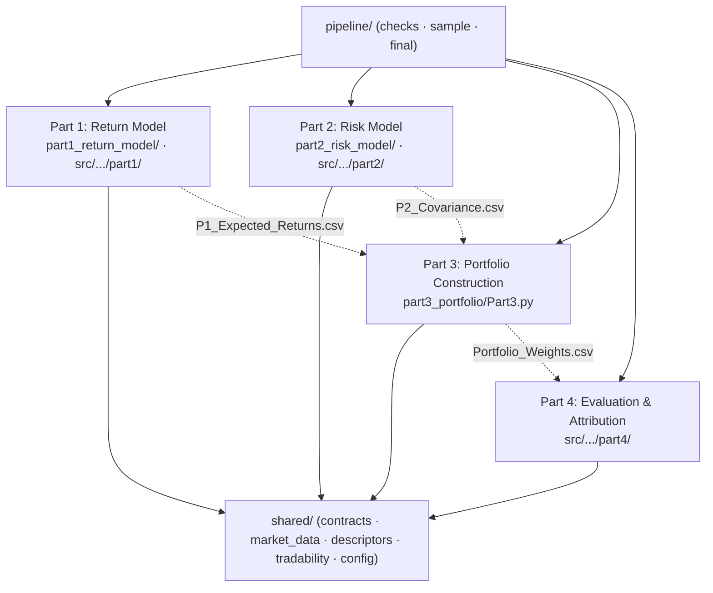

<div align="center">

# STA4020 Final Project

**Forecasting and Allocating Across 50 China A-Shares (Jan 2015 – Aug 2024)**

English | [简体中文](README.zh-CN.md)

[](pyproject.toml)
[](https://docs.astral.sh/uv/)
[](docs/final_report.typ)
[](#key-results)
[](tests/)

[Deliverables & Previews](#deliverables--previews) · [Key Results](#key-results) · [Architecture](#architecture) · [Quick Start](#quick-start) · [Reproduce Final](#reproduce-final-experiment) · [TODO](#todo--known-issues)

</div>

---

End-to-end monthly quantitative equity pipeline built for **CUHK-Shenzhen STA4020**: return forecasting (**Part 1**), Barra-style risk modeling (**Part 2**), constrained portfolio construction (**Part 3**), and out-of-sample evaluation with statistical inference and attribution (**Part 4**).

## Deliverables & Previews

Click either thumbnail or link below to view the compiled PDFs directly in GitHub's PDF viewer:

| Deliverable | Direct Preview (PDF) | Source (Typst) | Notes |
| --- | --- | --- | --- |
| **Final Report** | [Final_Report.pdf](docs/deliverables/Final_Report.pdf) | [final_report.typ](docs/final_report.typ) | 5 chapters, tables & figures bound to `manifest.json` |
| **Presentation Slides** | [Final_Slides.pdf](docs/deliverables/Final_Slides.pdf) | [final_slides.typ](docs/final_slides.typ) | 8-slide 16:9 deck covering Parts 1–4 |
| **Experiment Design** | [FINAL_EXPERIMENT_DESIGN.md](docs/FINAL_EXPERIMENT_DESIGN.md) | — | Pre-registered selection, risk & execution rules |
| **Engineering Plan** | [PLAN.md](docs/PLAN.md) | — | Deadlines, CSV contracts, work breakdown & risks |

<table>
  <tr>
    <td width="50%" align="center">
      <a href="docs/deliverables/Final_Report.pdf">
        
      </a>
      <br />
      <strong><a href="docs/deliverables/Final_Report.pdf">Open Final Report (PDF)</a></strong>
    </td>
    <td width="50%" align="center">
      <a href="docs/deliverables/Final_Slides.pdf">
        
      </a>
      <br />
      <strong><a href="docs/deliverables/Final_Slides.pdf">Open Presentation Slides (PDF)</a></strong>
    </td>
  </tr>
</table>

<details>
<summary><strong>Preview all 8 presentation slides inline</strong> (click to expand)</summary>

<br />

<table>
  <tr>
    <td width="50%"><a href="docs/deliverables/Final_Slides.pdf"></a></td>
    <td width="50%"><a href="docs/deliverables/Final_Slides.pdf"></a></td>
  </tr>
  <tr>
    <td width="50%"><a href="docs/deliverables/Final_Slides.pdf"></a></td>
    <td width="50%"><a href="docs/deliverables/Final_Slides.pdf"></a></td>
  </tr>
  <tr>
    <td width="50%"><a href="docs/deliverables/Final_Slides.pdf"></a></td>
    <td width="50%"><a href="docs/deliverables/Final_Slides.pdf"></a></td>
  </tr>
  <tr>
    <td width="50%"><a href="docs/deliverables/Final_Slides.pdf"></a></td>
    <td width="50%"><a href="docs/deliverables/Final_Slides.pdf"></a></td>
  </tr>
</table>

</details>

## Key Results

Monthly out-of-sample evaluation across **116 realized months** (Jan 2015 – Aug 2024), **50 fixed A-shares**, **10% single-name cap**, **10 bp/side** cash-funded costs, and frozen suspended holdings:

| Strategy | Net Ann. Return | Ann. Volatility | Sharpe Ratio | Max Drawdown | Ann. Turnover |
| --- | ---: | ---: | ---: | ---: | ---: |
| **Mean–Variance Optimization** | **11.1%** | 36.4% | **0.408** | -49.3% | 7.91x |
| **Black–Litterman** | 7.3% | **34.1%** | 0.315 | **-47.2%** | 4.13x |
| **1/N (Eligible Benchmark)** | 7.3% | 34.4% | 0.315 | -50.5% | 1.01x |
| **Risk Parity** | 7.0% | 34.3% | 0.307 | -50.3% | **0.89x** |
| **Global Minimum Variance** | 4.2% | 34.4% | 0.230 | -49.7% | 3.41x |
| **Maximum Diversification** | -2.4% | 37.0% | 0.059 | -71.9% | 2.41x |

<p align="center">
  
</p>

## Architecture

The codebase uses a **Shared Kernel + 4 Autonomous Domains** layout enforced by AST import tests ([test_architecture.py](tests/test_architecture.py)). Parts exchange strictly defined CSV contracts and never import each other laterally.



### Repository Map

| Path | Role | Owner |
| --- | --- | --- |
| `part1_return_model/` | FM & tree notebooks; see [Part 1 guide](part1_return_model/README.md) | Part 1 |
| `part2_risk_model/` | Vendored Barra-style risk package (`risk_model`); see [PROVENANCE.md](part2_risk_model/PROVENANCE.md) | Part 2 |
| `part3_portfolio/` | Standalone & in-process portfolio CLI (`Part3.py`); see [Part 3 guide](part3_portfolio/README.md) | Part 3 |
| `part4_evaluation/` | Tagged evaluation outputs (`tables/`, `figures/`, `REPORT.md`, untracked) | Part 4 |
| `src/sta4020_project/` | Layered package: `shared/`, `part1/`, `part2/`, `part4/`, `pipeline/` | Shared |
| `artifacts/` | Cross-part CSV contracts (`part1/`, `part2/`, `part3/`, `sample/`) | Shared |
| `data/` | Raw course data (~530 MB + 609 MB descriptors, untracked); see [data/README.md](data/README.md) | Shared |
| `docs/` | Guidelines, plan, Typst sources, compiled PDFs (`deliverables/`) & PNGs (`previews/`) | Shared |
| `tests/` | Unit & AST architecture tests (96 tests total with `part2_risk_model/tests`) | Shared |

## Quick Start

Only [uv](https://docs.astral.sh/uv/) is required (automatically provisions Python ≥ 3.11 from `uv.lock`). Run all commands from the repository root:

```bash
# 1. Clone and sync locked environment
git clone https://github.com/ShenYouSOTA/sta4020-group-project.git
cd sta4020-group-project
uv sync --locked --extra risk --extra final

# 2. Verify tests and end-to-end mock smoke test (no raw data needed)
uv run --locked --extra risk --extra final pytest tests part2_risk_model/tests
uv run sta4020-sample

# 3. Copy course data into data/, then verify data and CSV contracts
uv run sta4020-check-data
uv run sta4020-check-artifacts
```

## Reproduce Final Experiment

Runs all 4 covariance estimators, return model selection, sensitivities, risk/style attribution, and contract audits into a fresh tag:

```bash
OPENBLAS_NUM_THREADS=1 uv run --locked --extra risk --extra final sta4020-run-final --tag final-recheck
```

Compile PDFs and refresh README previews with [Typst](https://typst.app/):

```bash
# Compile report and slides (add `--input tag=final-recheck` for a custom tag)
typst compile --root . docs/final_report.typ docs/deliverables/Final_Report.pdf
typst compile --root . docs/final_slides.typ docs/deliverables/Final_Slides.pdf

# Refresh PNG previews
typst compile --root . --format png --ppi 120 --pages 1 docs/final_report.typ docs/previews/report_p1.png
typst compile --root . --format png --ppi 120 docs/final_slides.typ 'docs/previews/slides_p{p}.png'
```

<details>
<summary><strong>Step-by-step & custom CLI commands</strong> (click to expand)</summary>

```bash
# Part 1: rebuild FM + lagged accounting forecasts
uv run --locked --extra final sta4020-build-returns --output-dir artifacts/part1/run1

# Part 2: build covariance (--method broad-factor | factor | sample | ledoit-wolf)
uv run --locked --extra risk sta4020-build-risk --method broad-factor --output artifacts/part2/run1.csv

# Part 3: optimize portfolios
uv run python part3_portfolio/Part3.py \
  --covariance artifacts/part2/run1.csv \
  --max-weight 0.10 \
  --output-dir artifacts/part3/run1

# Part 4: validate and evaluate (--cost-sweep '' skips 0/10/30/50 bp table)
uv run sta4020-check-artifacts --weights artifacts/part3/run1/Portfolio_Weights.csv
uv run sta4020-evaluate --tag run1 --cost-bps 10 --freeze-suspensions \
  --weights artifacts/part3/run1/Portfolio_Weights.csv
```

Pass `--descriptors /path/to/descriptors.pkl` to reuse an unpacked copy of `data/addition/descriptors.zip` (compact subset cache is enabled automatically). Pass `--tradability-data data` to both Part 3 and Part 4 for custom forecast files.

</details>

## Working Agreement

- **Branches & PRs:** One branch per part (`part1/`–`part4/`) merging into `main`; run `pytest`, `sta4020-check-data`, and `sta4020-check-artifacts` before review.
- **Reproducibility:** Keep `data/` and `_incoming/` untracked; write every evaluation run to a fresh tag; quote numbers solely from `part4_evaluation/reports/`.
- **Bilingual Docs:** Keep `*.md` and `*.zh-CN.md` in sync when changing commands, paths, or contracts. Leave upstream `part2_risk_model/` docs untouched.

## TODO & Known Issues

Tracked backtest, contract, and experimental-design issues from recent audits (Part 4 execution passed a 6-cutoff [Freqtrade-style sliced replay](https://www.freqtrade.io/en/stable/lookahead-analysis/) under fixed weights/flags; 96 tests pass):

- [ ] **P1 · Eliminate same-close look-ahead across Parts 2–4** ([broad_risk.py](src/sta4020_project/part2/broad_risk.py), [Part3.py](part3_portfolio/Part3.py), [backtest.py](src/sta4020_project/part4/backtest.py)): Part 1 signals form at the penultimate close (labels through `t-1`), but Model B covariance uses month-`t` full factor/residual returns and month-end styles while assuming fills at the same month-`t` close. Lagging Model B covariance by one month over the common 115 months shifts MVO net Sharpe from `0.3820` to `0.4177`. Adopt one verifiable rule for all strategies and `1/N`: freeze all optimization inputs before the order cutoff ([Backtrader execution](https://www.backtrader.com/docu/order-creation-execution/order-creation-execution/), [LEAN MOC](https://www.quantconnect.com/docs/v2/writing-algorithms/trading-and-orders/order-types/market-on-close-orders)), or defer execution and recompute returns from the actual fill timestamp.
- [ ] **P1 · Require valid execution-close quotes for fills** ([tradability.py](src/sta4020_project/shared/tradability.py), [backtest.py](src/sta4020_project/part4/backtest.py)): execution masks rely only on vendor flags whose intraday visibility is undocumented. On `2021-10-29`, `300354.SZ` lacked a close quote yet Black–Litterman opened a `4.17%` position (GMV rose from `~1.07%` to `6.93%`) and booked `+34.49%` measured from the stale `2021-10-28` close; freezing missing-quote fills alone reduces Black–Litterman net Sharpe from `0.2853` to `0.2829`. Separate valuation marks from fill validation ([LEAN trade fills](https://www.quantconnect.com/docs/v2/writing-algorithms/reality-modeling/trade-fills/key-concepts)), apply identically to strategies and `1/N`, and rerun affected outputs.
- [ ] **P1 · Guard all report writers against overwriting finalized runs** ([sample.py](src/sta4020_project/pipeline/sample.py), [cli.py](src/sta4020_project/part4/cli.py)): `sta4020-sample --tag final` writes directly into `reports/final`, overwriting performance tables while leaving the original `manifest.json` intact. Enforce finalized-directory protection inside every report write path.
- [ ] **P2 · Anchor max drawdown to initial wealth (`1.0`)** ([metrics.py](src/sta4020_project/part4/metrics.py), [Part3.py](part3_portfolio/Part3.py)): `[-20%, +10%]` currently reports `0%` instead of `-20%`. Full-sample net drawdown across all six paths is unchanged, while MVO's 2021 subperiod drawdown corrects from `-5.15%` to `-9.50%`.
- [ ] **P2 · Enforce 1-to-1 next-month alignment in shared contracts** ([contracts.py](src/sta4020_project/shared/contracts.py), [Part3.py](part3_portfolio/Part3.py), [final.py](src/sta4020_project/pipeline/final.py)): `target_dates` maps both Jan and Feb origins to Mar if Feb returns are missing, passing `audit` until Part 4 fails late. Move the strict next-month check from `final.py` into `contracts.py`.
- [ ] **P2 · Wire `FinalExperimentConfig` into execution and fix manifest reproduction command** ([config.py](src/sta4020_project/shared/config.py), [final.py](src/sta4020_project/pipeline/final.py)): `part1`, `part2`, `bl_tau`, and `cost_sweep` are logged in `manifest.json` without driving downstream runs (defaults match current constants). Also emit a fresh-tag reproduction command that preserves explicit `--descriptors`.
- [ ] **P2 · Extend sliced look-ahead replay upstream** ([features.py](src/sta4020_project/part1/features.py), [broad_risk.py](src/sta4020_project/part2/broad_risk.py), [Part3.py](part3_portfolio/Part3.py)): extend the 6-cutoff future-return perturbation replay from Part 4 execution to upstream feature, covariance, and weight generation.
- [ ] **Design · Separate model selection from post-selection evaluation & audit restatements** ([final.py](src/sta4020_project/pipeline/final.py), [final_report.typ](docs/final_report.typ)): the same 116-month window selects between FM and the accounting extension and reports the selected model's metrics, and a 1-month lag does not rule out vendor restatement back-filling ([CFA Institute model validation](https://rpc.cfainstitute.org/-/media/documents/article/rf-brief/investment-model-validation.pdf)). Frame current results as model-comparison evidence or reserve a post-selection holdout.
