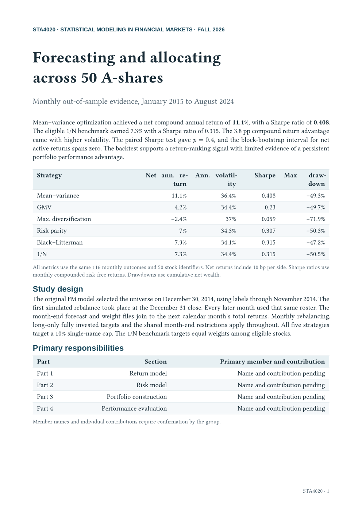
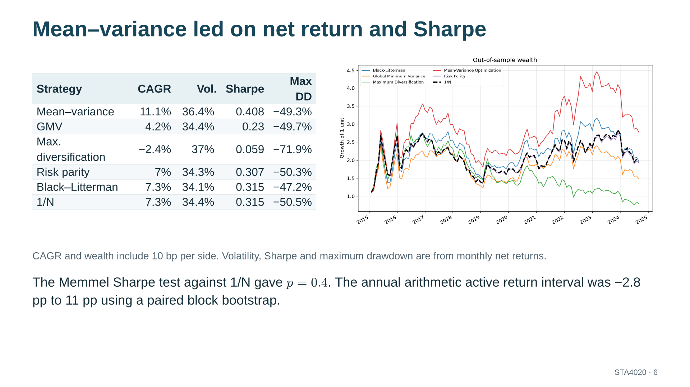
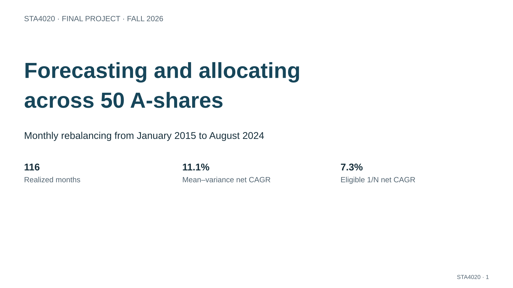
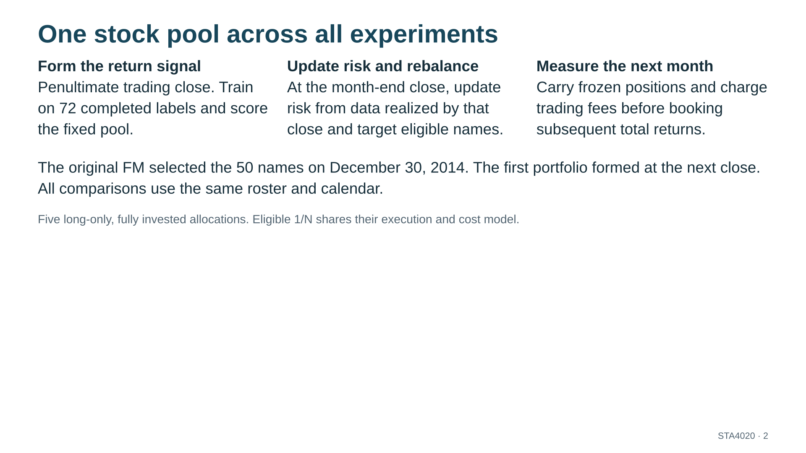
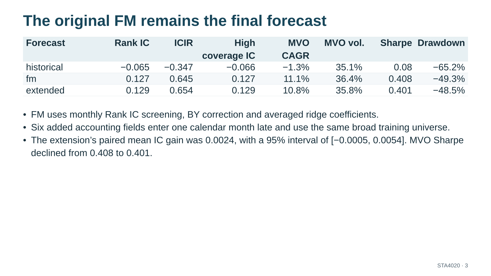
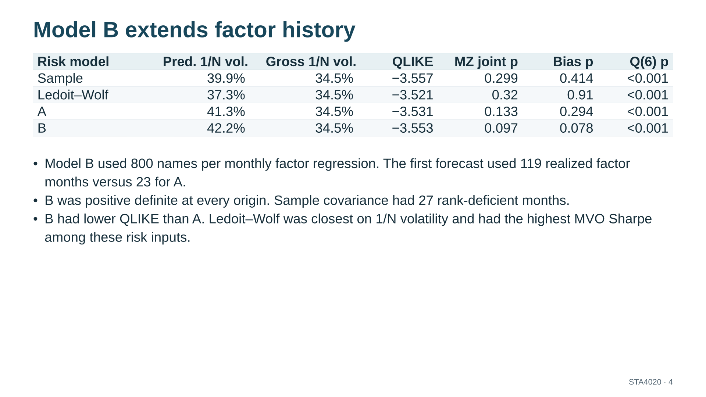
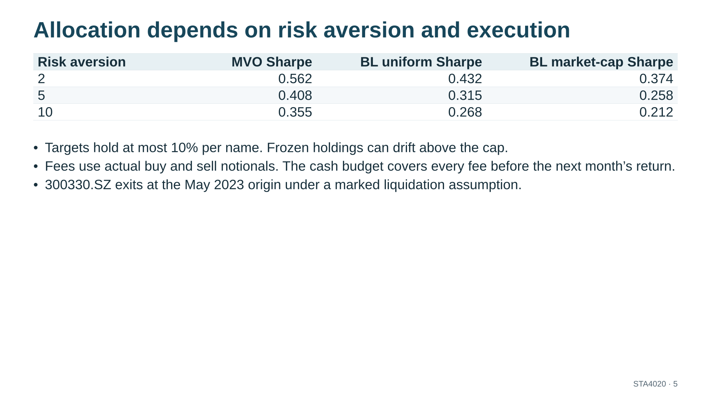
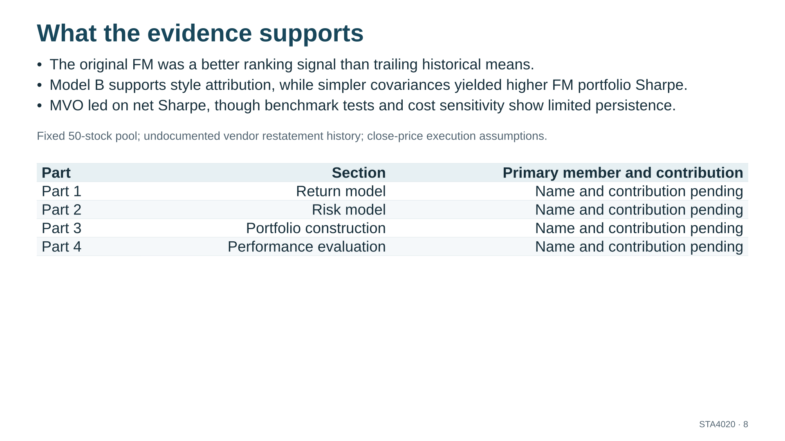
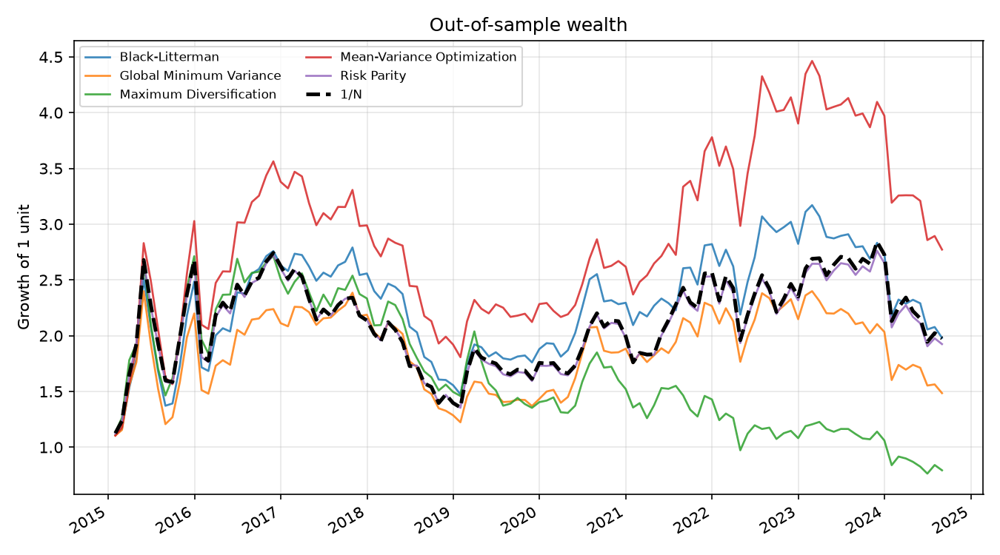
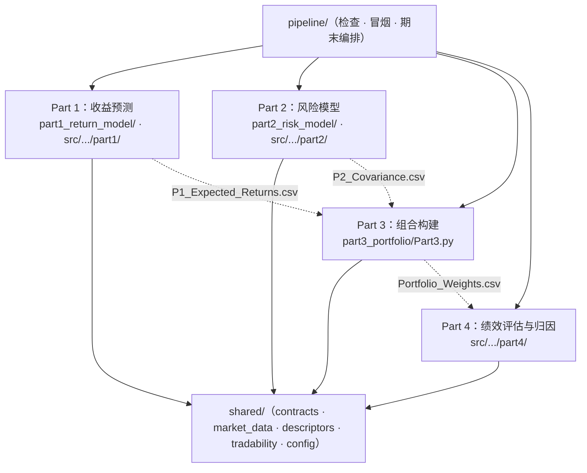

<div align="center">

# STA4020 期末小组项目

**50 只中国 A 股的月度收益预测与组合配置（2015 年 1 月 – 2024 年 8 月）**

[English](README.md) | 简体中文

[](pyproject.toml)
[](https://docs.astral.sh/uv/)
[](docs/final_report.typ)
[](#核心结果)
[](tests/)

[报告与 PPT 预览](#报告与-ppt-预览) · [核心结果](#核心结果) · [项目架构](#项目架构) · [快速开始](#快速开始) · [复现期末实验](#复现期末实验) · [待办清单](#待办与已知问题todo)

</div>

---

**香港中文大学（深圳）STA4020** 端到端月度量化权益研究流程，包含四个自治部分：预期收益预测（**Part 1**）、Barra 风格风险模型（**Part 2**）、约束投资组合构建（**Part 3**）以及样本外评估、统计检验与归因分析（**Part 4**）。

## 报告与 PPT 预览

点击下方缩略图或链接，可在 GitHub 中直接在线预览编译好的 PDF 报告与演示文稿：

| 交付物 | 在线预览（PDF） | Typst 源码 | 说明 |
| --- | --- | --- | --- |
| **期末报告** | [Final_Report.pdf](docs/deliverables/Final_Report.pdf) | [final_report.typ](docs/final_report.typ) | 完整 5 章，数据表与图表自动绑定 `manifest.json` |
| **汇报 PPT** | [Final_Slides.pdf](docs/deliverables/Final_Slides.pdf) | [final_slides.typ](docs/final_slides.typ) | 8 页 16:9 演示文稿，涵盖 Part 1–4 核心发现 |
| **期末实验设计** | [FINAL_EXPERIMENT_DESIGN.md](docs/FINAL_EXPERIMENT_DESIGN.md) | — | 预登记模型筛选、风险对照与成交成本口径 |
| **工程计划** | [PLAN.zh-CN.md](docs/PLAN.zh-CN.md) | — | 截止时间、CSV 产物契约、任务拆解与风险清单 |

<table>
  <tr>
    <td width="50%" align="center">
      <a href="docs/deliverables/Final_Report.pdf">
        
      </a>
      <br />
      <strong><a href="docs/deliverables/Final_Report.pdf">查看期末报告（PDF）</a></strong>
    </td>
    <td width="50%" align="center">
      <a href="docs/deliverables/Final_Slides.pdf">
        
      </a>
      <br />
      <strong><a href="docs/deliverables/Final_Slides.pdf">查看汇报 PPT（PDF）</a></strong>
    </td>
  </tr>
</table>

<details>
<summary><strong>点击展开：在线浏览全部 8 页 PPT 缩略图</strong></summary>

<br />

<table>
  <tr>
    <td width="50%"><a href="docs/deliverables/Final_Slides.pdf"></a></td>
    <td width="50%"><a href="docs/deliverables/Final_Slides.pdf"></a></td>
  </tr>
  <tr>
    <td width="50%"><a href="docs/deliverables/Final_Slides.pdf"></a></td>
    <td width="50%"><a href="docs/deliverables/Final_Slides.pdf"></a></td>
  </tr>
  <tr>
    <td width="50%"><a href="docs/deliverables/Final_Slides.pdf"></a></td>
    <td width="50%"><a href="docs/deliverables/Final_Slides.pdf"></a></td>
  </tr>
  <tr>
    <td width="50%"><a href="docs/deliverables/Final_Slides.pdf"></a></td>
    <td width="50%"><a href="docs/deliverables/Final_Slides.pdf"></a></td>
  </tr>
</table>

</details>

## 核心结果

覆盖 **116 个样本外实现月份**（2015-01 至 2024-08）、**50 只固定 A 股**、**10% 单股权重上限**、**单边 10 bp** 现金扣费及停牌冻结规则：

| 策略 | 净年化收益 | 年化波动率 | 夏普比率 | 最大回撤 | 年化换手 |
| --- | ---: | ---: | ---: | ---: | ---: |
| **均值方差优化（MVO）** | **11.1%** | 36.4% | **0.408** | -49.3% | 7.91x |
| **Black–Litterman** | 7.3% | **34.1%** | 0.315 | **-47.2%** | 4.13x |
| **1/N（可交易等权基准）** | 7.3% | 34.4% | 0.315 | -50.5% | 1.01x |
| **风险平价（Risk Parity）** | 7.0% | 34.3% | 0.307 | -50.3% | **0.89x** |
| **全局最小方差（GMV）** | 4.2% | 34.4% | 0.230 | -49.7% | 3.41x |
| **最大分散化** | -2.4% | 37.0% | 0.059 | -71.9% | 2.41x |

<p align="center">
  
</p>

## 项目架构

采用**「极薄共享内核 + 四个自治域」**分层设计，由 AST 边界测试（[test_architecture.py](tests/test_architecture.py)）自动守护。四部分之间严禁横向代码依赖，仅通过标准化 CSV 契约交接：



### 目录一览

| 路径 | 用途 | 负责人 |
| --- | --- | --- |
| `part1_return_model/` | FM 与树模型 notebook；见 [Part 1 指南](part1_return_model/README.md) | Part 1 |
| `part2_risk_model/` | 随仓库附带的 Barra 风格风险包（`risk_model`）；见 [PROVENANCE.md](part2_risk_model/PROVENANCE.md) | Part 2 |
| `part3_portfolio/` | 组合构建 CLI（`Part3.py`），支持独立运行与进程内调用；见 [Part 3 指南](part3_portfolio/README.zh-CN.md) | Part 3 |
| `part4_evaluation/` | 按标签存放的评估报告（`tables/`、`figures/`、`REPORT.md`，不提交） | Part 4 |
| `src/sta4020_project/` | 分层包：`shared/`、`part1/`、`part2/`、`part4/`、`pipeline/` | 共享 |
| `artifacts/` | 跨部分 CSV 产物（`part1/`、`part2/`、`part3/`、`sample/`） | 共享 |
| `data/` | 原始课程数据（约 530 MB + 609 MB 描述变量，不提交）；见[数据说明](data/README.zh-CN.md) | 共享 |
| `docs/` | 项目要求、计划、Typst 源码、编译成品（`deliverables/`）与预览图（`previews/`） | 共享 |
| `tests/` | 单元测试与 AST 架构边界测试（与 `part2_risk_model/tests` 共 96 项） | 共享 |

## 快速开始

仅需安装 [uv](https://docs.astral.sh/uv/)（自动按 [uv.lock](uv.lock) 获取 Python ≥ 3.11 并同步依赖），所有命令从仓库根目录执行：

```bash
# 1. 克隆仓库并同步锁定环境
git clone https://github.com/ShenYouSOTA/sta4020-group-project.git
cd sta4020-group-project
uv sync --locked --extra risk --extra final

# 2. 运行单元测试与模拟数据端到端冒烟测试（无需原始数据）
uv run --locked --extra risk --extra final pytest tests part2_risk_model/tests
uv run sta4020-sample

# 3. 将课程数据复制到 data/ 后，校验数据与 CSV 契约
uv run sta4020-check-data
uv run sta4020-check-artifacts
```

## 复现期末实验

一键运行全部 4 种协方差估计、收益模型筛选、敏感性分析、风险/风格归因与契约门禁审计（写入独立新标签）：

```bash
OPENBLAS_NUM_THREADS=1 uv run --locked --extra risk --extra final sta4020-run-final --tag final-recheck
```

使用 [Typst](https://typst.app/) 重新编译 PDF 并刷新 README 预览图：

```bash
# 编译报告与 PPT（自定义标签时传入 `--input tag=final-recheck`）
typst compile --root . docs/final_report.typ docs/deliverables/Final_Report.pdf
typst compile --root . docs/final_slides.typ docs/deliverables/Final_Slides.pdf

# 刷新 PNG 预览图
typst compile --root . --format png --ppi 120 --pages 1 docs/final_report.typ docs/previews/report_p1.png
typst compile --root . --format png --ppi 120 docs/final_slides.typ 'docs/previews/slides_p{p}.png'
```

<details>
<summary><strong>分步运行与自定义参数命令</strong>（点击展开）</summary>

```bash
# Part 1：复现 FM 与滞后会计扩展预测
uv run --locked --extra final sta4020-build-returns --output-dir artifacts/part1/run1

# Part 2：构建协方差（--method broad-factor | factor | sample | ledoit-wolf）
uv run --locked --extra risk sta4020-build-risk --method broad-factor --output artifacts/part2/run1.csv

# Part 3：构建组合权重
uv run python part3_portfolio/Part3.py \
  --covariance artifacts/part2/run1.csv \
  --max-weight 0.10 \
  --output-dir artifacts/part3/run1

# Part 4：校验与评估（传入 --cost-sweep '' 可跳过 0/10/30/50 bp 敏感性表）
uv run sta4020-check-artifacts --weights artifacts/part3/run1/Portfolio_Weights.csv
uv run sta4020-evaluate --tag run1 --cost-bps 10 --freeze-suspensions \
  --weights artifacts/part3/run1/Portfolio_Weights.csv
```

若已有解压后的描述变量文件，可传入 `--descriptors /path/to/descriptors.pkl`（内置紧凑子集缓存会自动复用）。使用自定义预测文件时，在 Part 3 与 Part 4 同时传入 `--tradability-data data`。

</details>

## 协作约定

- **分支与审查：** 按部分建立独立分支（`part1/`–`part4/`）并经 PR 合入 `main`；提审前运行 `pytest`、`sta4020-check-data` 与 `sta4020-check-artifacts`。
- **可复现性：** 不提交 `data/` 与 `_incoming/`；每次评估写入独立运行标签目录；报告引用数值仅取自 `part4_evaluation/reports/`。
- **双语文档：** 修改命令、路径或契约时同步更新 `*.md` 与 `*.zh-CN.md`；上游 `part2_risk_model/` 文档保持原样。

## 待办与已知问题（TODO）

按优先级记录最新代码与回测审计发现的问题（固定权重与标记下，Part 4 执行层已通过 6 截点 [Freqtrade 风格切片重放](https://www.freqtrade.io/en/stable/lookahead-analysis/)，96 项测试全部通过）：

- [ ] **P1 · 消除跨 Part 2–4 的同收盘前视**（[broad_risk.py](src/sta4020_project/part2/broad_risk.py)、[Part3.py](part3_portfolio/Part3.py)、[backtest.py](src/sta4020_project/part4/backtest.py)）：Part 1 信号在倒数第二个交易日收盘生成（训练标签最晚到上月），但最终 B 协方差纳入了当月完整因子收益、残差收益与月末风格暴露，同时假设按同一个月末收盘价成交。在共同 115 个月仅将 B 协方差滞后一月，MVO 净 Sharpe 从 `0.3820` 升至 `0.4177`。需在策略与 `1/N` 上统一落地一条可验证规则：保留月末收盘成交则将全部优化输入冻结在下单截止前（参考 [Backtrader 成交规则](https://www.backtrader.com/docu/order-creation-execution/order-creation-execution/)、[LEAN 收盘竞价单](https://www.quantconnect.com/docs/v2/writing-algorithms/trading-and-orders/order-types/market-on-close-orders)），或推迟成交并从实际成交端点重算收益。
- [ ] **P1 · 将有效执行收盘报价纳入成交验证**（[tradability.py](src/sta4020_project/shared/tradability.py)、[backtest.py](src/sta4020_project/part4/backtest.py)）：当前执行掩码仅依赖供应商标记，且无法确认月底停牌/黑名单何时对策略可见。`2021-10-29` `300354.SZ` 缺失收盘报价，Black–Litterman 仍从零建仓至 `4.17%`（GMV 从约 `1.07%` 加仓至 `6.93%`），随后计入的 `+34.49%` 精确等于 11 月末相对 `10-28` 旧报价的涨幅；单独加入缺价冻结后，Black–Litterman 净 Sharpe 从 `0.2853` 降至 `0.2829`。需将估值沿用旧价与成交报价验证解耦（参考 [LEAN 成交模型](https://www.quantconnect.com/docs/v2/writing-algorithms/reality-modeling/trade-fills/key-concepts)），对策略与 `1/N` 统一应用并重跑受影响结果。
- [ ] **P1 · 所有报告写入入口统一保护已完成目录**（[sample.py](src/sta4020_project/pipeline/sample.py)、[cli.py](src/sta4020_project/part4/cli.py)）：`sta4020-sample --tag final` 会绕过正式评估 CLI 保护，直接覆盖 `reports/final` 下的业绩表而保留原 `manifest.json`。需在统一写入层拦截对已完成目录的覆盖。
- [ ] **P2 · 最大回撤补齐期初净值（`1.0`）**（[metrics.py](src/sta4020_project/part4/metrics.py)、[Part3.py](part3_portfolio/Part3.py)）：当前 `[-20%, +10%]` 会算得 `0%` 而非 `-20%`。六条全期净收益路径的最大回撤恰好未受影响，但 2021 年 MVO 分段回撤需从 `-5.15%` 修正为 `-9.50%`。
- [ ] **P2 · 将严格次月日期校验下沉至共享契约**（[contracts.py](src/sta4020_project/shared/contracts.py)、[Part3.py](part3_portfolio/Part3.py)、[final.py](src/sta4020_project/pipeline/final.py)）：若缺失 2 月收益，1 月末和 2 月末预测都会映射到 3 月末，通用 `audit` 仍返回 `PASS`，Part 3 会写出重复实现日期，Part 4 到模拟末期才报错。需将 `final.py` 的连续次月校验迁移至 `contracts.py` 供各入口共用。
- [ ] **P2 · 让 `FinalExperimentConfig` 实际驱动下游计算并修正复现命令**（[config.py](src/sta4020_project/shared/config.py)、[final.py](src/sta4020_project/pipeline/final.py)）：`manifest.json` 记录了 `part1`、`part2`、`bl_tau` 与 `cost_sweep`，但修改这些字段目前不会改变对应计算（默认值与当前常量一致）；此外清单里的复现命令复用了已占用的原 `--tag`，且遗漏显式传入的 `--descriptors`。
- [ ] **P2 · 将切片前视重放扩展至上游全链路**（[features.py](src/sta4020_project/part1/features.py)、[broad_risk.py](src/sta4020_project/part2/broad_risk.py)、[Part3.py](part3_portfolio/Part3.py)）：将 Part 4 的 6 截点未来收益替换重放检查扩展到上游特征、协方差与权重生成。
- [ ] **实验设计 · 区分模型选择期与最终评估期，并核查财务重述**（[final.py](src/sta4020_project/pipeline/final.py)、[final_report.typ](docs/final_report.typ)）：流程在同一 116 个月内同时完成扩展模型筛选与最终表现报告，且一月滞后无法排除供应商历史财报重述回填（参考 [CFA Institute 投资模型验证](https://rpc.cfainstitute.org/-/media/documents/article/rf-brief/investment-model-validation.pdf)）。应将当前结果表述为模型比较与选择证据，或另留未参与选择的评估期。
